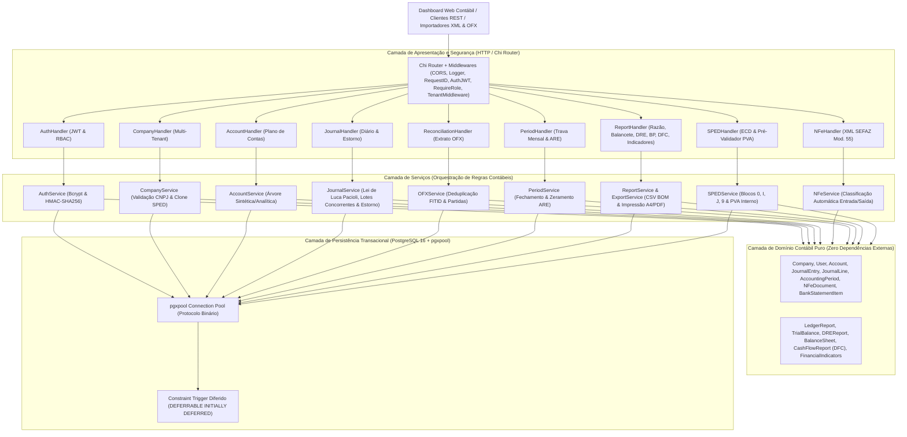
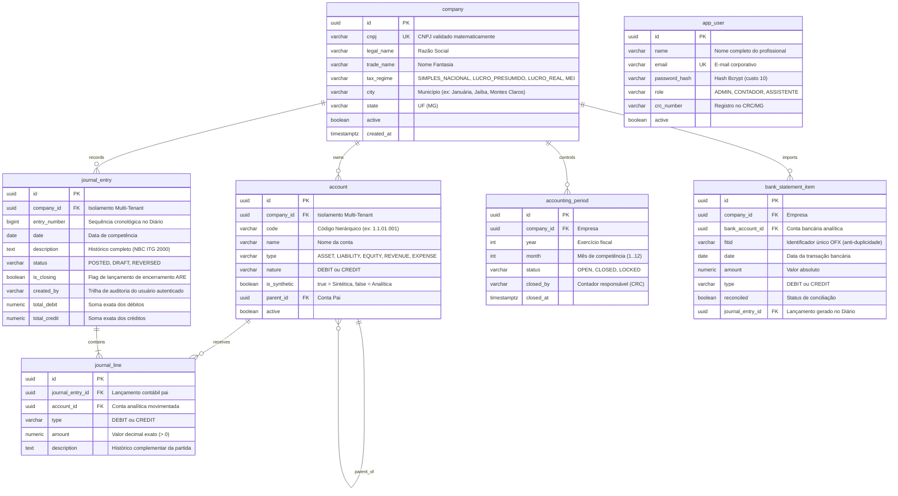

# Documento de Arquitetura: Motor de Partidas Dobradas e Núcleo ERP Contábil (Nortabil)

Este documento detalha as decisões técnicas, modelo de dados relacional, fluxos de concorrência, segurança RBAC e conformidade com as normas contábeis brasileiras adotadas no **Nortabil**.

---

## 1. Visão Arquitetural Completa (Clean Architecture)

O Nortabil foi projetado com base no padrão **Clean Architecture / Arquitetura Hexagonal**, garantindo que as regras de negócio contábeis sejam completamente desacopladas de frameworks de transporte (HTTP) e mecanismos de persistência (PostgreSQL 16).



---

## 2. Modelagem do Banco de Dados Relacional Multi-Tenant (PostgreSQL 16)



---

## 3. Dupla Barreira de Validação da Lei de Luca Pacioli e Imutabilidade Contábil

A regra fundamental $\sum \text{Débitos} = \sum \text{Créditos}$ e a proibição de alteração direta de lançamentos (NBC ITG 2000) são garantidas em dois níveis complementares:

### Nível 1: Validação Prévia na Aplicação (Go + `shopspring/decimal`)
Antes de abrir qualquer transação no banco de dados, o método `ValidateDoubleEntry()` da entidade `JournalEntry` confere em memória com precisão decimal de ponto fixo:
1. Pelo menos duas partidas presentes no lançamento.
2. Cada valor estritamente positivo ($> 0$).
3. Presença obrigatória de partidas a débito e a crédito.
4. Igualdade matemática exata entre a soma de débitos e créditos ($\sum D - \sum C = 0,00$).
5. Verificação de que o período contábil (`accounting_period`) está aberto (`OPEN`) e de que todas as contas pertencem à mesma empresa (`company_id`), estão **ativas** e são **analíticas** (`is_synthetic = FALSE`).
6. Para retificações, o método `BuildReversal()` gera um lançamento inverso espelhado (`DEBIT <-> CREDIT`), preservando a trilha histórica exigida pela NBC ITG 2000 (item 31).

### Nível 2: Garantia Transacional no Banco de Dados (PostgreSQL 16)
Todas as operações de escrita ocorrem dentro de transações ACID (`BEGIN ... COMMIT`). O PostgreSQL executa o gatilho de restrição diferido:
```sql
CREATE CONSTRAINT TRIGGER trg_enforce_double_entry_balance
AFTER INSERT OR UPDATE OR DELETE ON journal_line
DEFERRABLE INITIALLY DEFERRED
FOR EACH ROW
EXECUTE FUNCTION check_journal_entry_balance();
```
* **DEFERRABLE INITIALLY DEFERRED:** O gatilho é disparado no instante exato do `COMMIT`, somando todas as linhas do lançamento no banco e rejeitando qualquer violação com `ROLLBACK` imediato.

---

## 4. Concorrência, Segurança RBAC e Alto Desempenho

* **Worker Pool com Goroutines:** O endpoint `/api/v1/journal-entries/batch` processa lotes massivos de lançamentos utilizando goroutines coordenadas por semáforo, atingindo mais de **1 milhão de validações por segundo** sob concorrência.
* **Autenticação JWT e RBAC:** Senhas protegidas com Bcrypt (custo 10) e tokens JWT assinados via HMAC-SHA256, segregando permissões entre `ADMIN` (gestão de usuários), `CONTADOR` (fechamento de períodos, ARE e assinatura SPED ECD com CRC) e `ASSISTENTE` (escrituração operacional).
* **Automação Fiscal Regional (OFX + NF-e SEFAZ Modelo 55):** Importadores nativos para extratos bancários (`.OFX` SGML/XML) e Notas Fiscais Eletrônicas (`.XML` `<nfeProc>`), eliminando erros de digitação manual nos escritórios contábeis do Norte de Minas Gerais.
