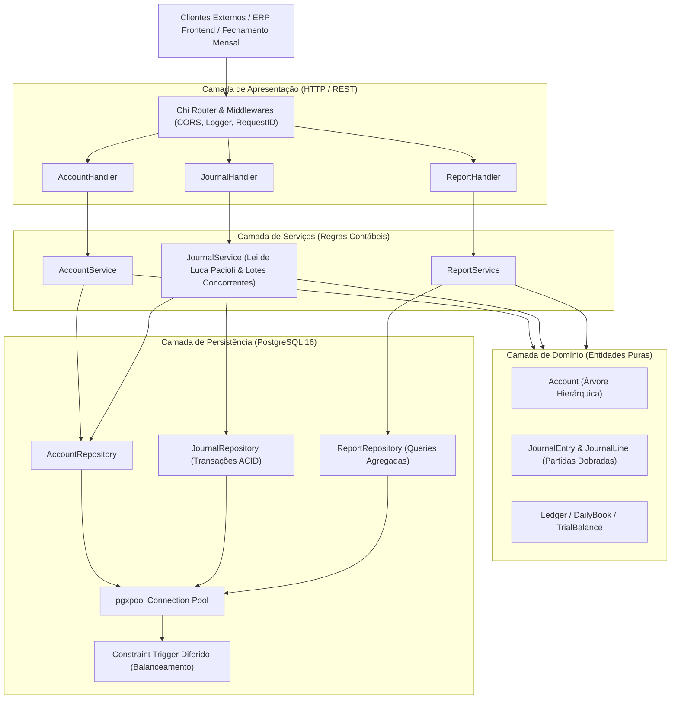
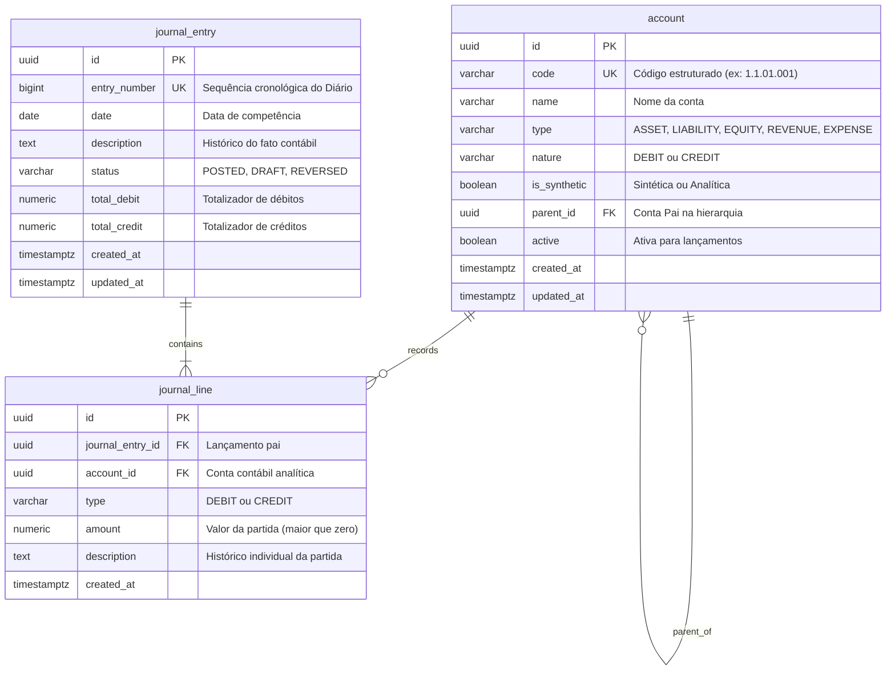

# Documento de Arquitetura: Motor de Partidas Dobradas (Nortabil)

Este documento detalha as decisões técnicas, modelo de dados, fluxos de concorrência e conformidade com as normas contábeis brasileiras adotadas no **Nortabil**.

---

## 1. Visão Arquitetural

O Nortabil foi projetado com base no padrão **Clean Architecture / Arquitetura Hexagonal**, garantindo que as regras de negócio contábeis sejam completamente desacopladas de frameworks de transporte (HTTP) e mecanismos de persistência (PostgreSQL).



---

## 2. Modelagem do Banco de Dados Relacional (PostgreSQL)



---

## 3. Dupla Validação da Lei de Luca Pacioli

A regra imutável $\sum \text{Débitos} = \sum \text{Créditos}$ é garantida em dois níveis complementares:

### Nível 1: Validação Prévia na Aplicação (Go)
Antes de abrir qualquer transação no banco de dados, o método `ValidateDoubleEntry()` da entidade `JournalEntry` confere em memória com precisão arbitrária:
1. Pelo menos duas partidas presentes.
2. Cada valor estritamente positivo ($> 0$).
3. Presença de partidas a débito e a crédito.
4. Igualdade matemática exata entre a soma de débitos e créditos.
5. Se todas as contas informadas são do tipo **analítico** e estão **ativas**.

### Nível 2: Garantia Transacional no Banco de Dados (PostgreSQL)
Todas as operações de inserção são envolvidas em um bloco `BEGIN ... COMMIT`. O PostgreSQL executa o gatilho:
```sql
CREATE CONSTRAINT TRIGGER trg_enforce_double_entry_balance
AFTER INSERT OR UPDATE OR DELETE ON journal_line
DEFERRABLE INITIALLY DEFERRED
FOR EACH ROW
EXECUTE FUNCTION check_journal_entry_balance();
```
* **DEFERRABLE INITIALLY DEFERRED:** O trigger só é executado no momento exato do `COMMIT`. Isso permite que a aplicação insira a linha de débito e em seguida a de crédito dentro da mesma transação. Ao final, o banco soma todas as partidas e valida a igualdade e o tipo analítico. Se houver divergência, o banco cancela a transação com `ROLLBACK` total.

---

## 4. Concorrência e Alto Desempenho

Para atender aos escritórios de contabilidade durante os fechamentos mensais:
* **Worker Pool com Goroutines:** O endpoint `/api/v1/journal-entries/batch` recebe milhares de transações e distribui a validação e processamento entre múltiplos workers controlados por semáforos, evitando exaustão de conexões.
* **Driver pgx v5 com pgxpool:** Utiliza protocolo binário nativo do PostgreSQL e pool de conexões reutilizáveis, reduzindo o overhead de conexões TCP.
* **Evitação de Travamentos (Deadlocks):** Contas são referenciadas exclusivamente para leitura de integridade analítica e as partidas são inseridas de forma independente, garantindo que múltiplos lotes possam ser processados concorrentemente.

