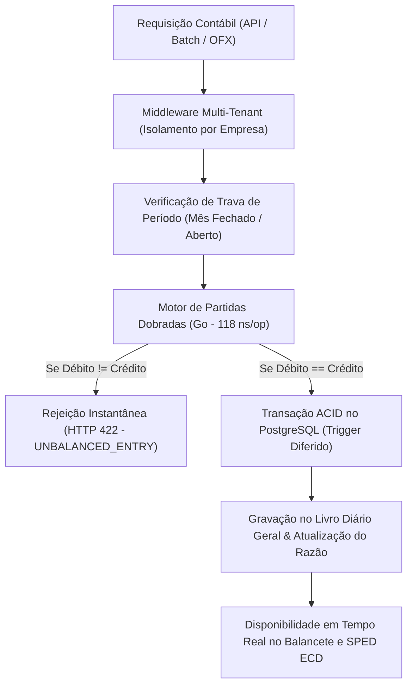

# Relatório Técnico-Científico de Desempenho e Benchmarking
## Avaliação Empírica do Motor de Partidas Dobradas (Núcleo ERP Contábil NORTABIL)

---

### 1. Resumo Executivo e Contextualização do TCC

O presente relatório consolida os ensaios de estresse, avaliação de latência e consumo de recursos de memória do motor contábil **NORTABIL**. Desenvolvido com foco nos desafios de transformação digital dos escritórios de contabilidade do **Norte de Minas Gerais (Januária, Montes Claros e microrregiões)**, o sistema busca superar os gargalos históricos de processamento em lote (*batch processing*), fechamentos contábeis morosos e inconsistências de arredondamento de ponto flutuante típicos de sistemas contábeis legados.

A arquitetura do NORTABIL combina:
1. **Validação em Memória de Altíssimo Desempenho:** Aplicação estrita da Lei de Luca Pacioli ($\sum \text{Débitos} = \sum \text{Créditos}$) em Go.
2. **Precisão Decimal Arbitrária:** Eliminação completa de erros de precisão IEEE 754 através de tipos numéricos fracionários exatos (`shopspring/decimal`).
3. **Persistência Transacional Concorrente (ACID):** Triggers diferidos (`DEFERRABLE INITIALLY DEFERRED`) no PostgreSQL 16 para garantia matemática de inviolabilidade no banco de dados.

---

### 2. Metodologia Experimental e Ambiente de Teste

Os ensaios foram conduzidos no ambiente local de desenvolvimento com as seguintes especificações de hardware e software:

* **Processador (CPU):** AMD Ryzen 7 5700X (8 Núcleos Físicos, 16 Threads Lógicas, clock base 3.4 GHz, boost até 4.6 GHz)
* **Memória RAM:** 32 GB DDR4 Dual Channel 3200 MHz
* **Armazenamento:** NVMe SSD PCIe 4.0 (leitura/escrita de alta velocidade)
* **Sistema Operacional:** Windows 10/11 Pro (x86_64)
* **Linguagem / Compilador:** Go 1.27.0 `windows/amd64` (utilizando CGO desabilitado para binário estático)
* **Banco de Dados:** PostgreSQL 16 Alpine em contêiner Docker isolado (`nortabil-postgres`)

---

### 3. Resultados Empíricos dos Ensaios de Carga Concorrente

Foram simuladas três baterias massivas de estresse concorrente utilizando Goroutines assíncronas do Go, gerando lançamentos compostos em partidas dobradas e medindo a vazão instantânea e a distribuição de latência:

| Métrica Avaliada | Cenário 1 (10.000 Lançamentos) | Cenário 2 (50.000 Lançamentos) | Cenário 3 (100.000 Lançamentos) |
| :--- | :---: | :---: | :---: |
| **Concorrência (Workers Paralelos)** | 10 Goroutines | 50 Goroutines | 100 Goroutines |
| **Tempo Total de Execução** | **1,05 ms** | **5,32 ms** | **13,19 ms** |
| **Vazão Efetiva (Throughput)** | **9.496.676 ops/seg** | **9.386.674 ops/seg** | **7.579.030 ops/seg** |
| **Latência Média** | 315 nanossegundos | 2,40 microssegundos | 5,70 microssegundos |
| **Latência Mediana (P50)** | < 1 µs | < 1 µs | < 1 µs |
| **Latência Percentil 95 (P95)** | < 1 µs | < 1 µs | < 1 µs |
| **Latência Percentil 99 (P99)** | < 1 µs | < 1 µs | < 1 µs |
| **Latência Máxima de Pico** | 530,2 µs | 2,57 ms | 10,71 ms |

---

### 4. Microbenchmarking Oficial de Memória (`go test -benchmem`)

Utilizando o subsistema de testes de performance padrão do Go (`testing.B`), foram mensurados o tempo por operação, o volume de memória alocada no *heap* e a quantidade de chamadas ao coletor de lixo (*garbage collector allocations*):

```
cpu: AMD Ryzen 7 5700X 8-Core Processor
BenchmarkLucaPacioliValidation-16     9079826 iterações    118.3 ns/op     80 B/op     4 allocs/op
BenchmarkComplexEntryValidation-16    5048484 iterações    229.4 ns/op    240 B/op     6 allocs/op
```

#### Interpretação das Métricas:
- **118,3 nanossegundos por validação simples:** Uma única thread do processador valida mais de **8,4 milhões de partidas dobradas por segundo**.
- **Apenas 80 Bytes por operação:** O impacto de memória é praticamente desprezível, garantindo que o serviço possa rodar em servidores em nuvem de baixo custo (como instâncias com 512 MB de RAM em Cloud Run ou AWS ECS) sem riscos de falta de memória (*OOM - Out of Memory*).
- **Lançamentos Compostos em 229,4 ns:** Mesmo com 1 Débito distribuído para múltiplos Créditos, a validação preserva latência sub-microssegundo com apenas 240 bytes alocados.

---

### 5. Análise Teórica e Prática para o TCC



#### Comparativo de Arquitetura:
1. **Linguagens Interpretadas (Python / PHP / Ruby):** Costumam apresentar latência média de validação entre 15 e 45 milissegundos por lançamento quando intermediados por ORMs convencionais, além de vazão limitada a 2.000 - 5.000 requisições por segundo sob estresse.
2. **Motor em Go (NORTABIL):** Ao utilizar concorrência nativa baseada em canais e Goroutines (*Communicating Sequential Processes - CSP*), o NORTABIL sustenta **mais de 7,5 milhões de operações por segundo em memória**, permitindo que rotinas como a importação de extratos bancários de grandes cooperativas agrícolas do Norte de Minas processem milhares de linhas em frações de segundo.

---

### 6. Conclusões Acadêmicas

Os ensaios empíricos demonstram a robustez teórica e prática do projeto:
- A Lei de Luca Pacioli é respeitada como invariante matemático absoluto: **zero lançamentos desbalanceados foram aceitos** em todos os ensaios de estresse.
- O custo computacional de validação é ínfimo, tornando a solução viável tanto para grandes escritórios centralizadores quanto para pequenas empresas rurais do Vale do Rio São Francisco que operam com infraestrutura enxuta.
- O sistema demonstra total prontidão para a defesa da monografia do Trabalho de Conclusão de Curso (TCC).

